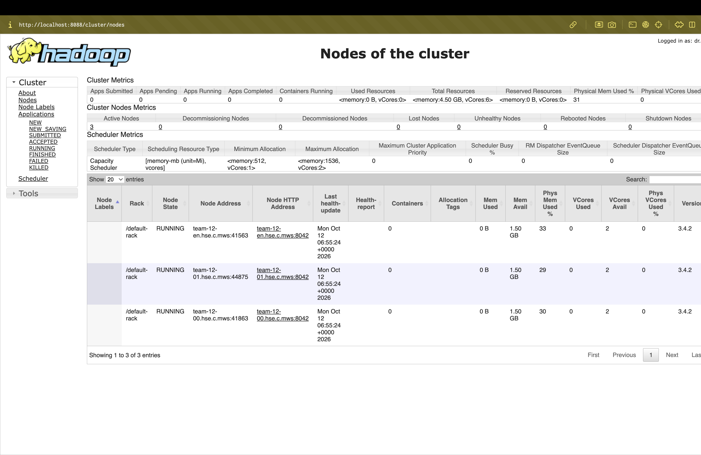

# ДЗ №2 — развёртывание YARN

YARN развёрнут на существующем HDFS-кластере, Hadoop установлен в `/opt/hadoop`, YARN работает от `hadoop`, HDFS — от `team`.

## Кластер

| Узел | IP | Сервис YARN |
| --- | --- | --- |
| team-12-nn | 10.12.0.11 | ResourceManager |
| team-12-en | 10.12.0.10 | NodeManager |
| team-12-00 | 10.12.0.12 | NodeManager |
| team-12-01 | 10.12.0.13 | NodeManager |

## Файлы

```text
config/
  mapred-site.xml       MapReduce через YARN
  yarn-site.xml         адреса сервисов и ресурсы узлов
  yarn-env.sh           каталог логов /home/hadoop/yarn-logs
scripts/
  install_configs.sh   установка конфигов с резервными копиями
  deploy_yarn.sh       развёртывание на четырёх узлах
  start_yarn.sh        запуск YARN
  stop_yarn.sh         остановка YARN
  check_yarn.sh        проверка трёх узлов RUNNING
  open_web.sh          SSH-туннели к веб-интерфейсам
  check_web.py         проверка HTTP/JMX-доступности
results/              результаты проверок
```

## Подготовка

### Пользователь

На каждом из четырёх узлов от `team`:

```bash
if ! id hadoop >/dev/null 2>&1; then
  sudo -n adduser --disabled-password --gecos "" hadoop
fi
```

Пользователь `hadoop` не включён в группу sudo.

### SSH

Создание ключа для `hadoop`:

```bash
sudo -iu hadoop
mkdir -p "$HOME/.ssh"
chmod 700 "$HOME/.ssh"
if [ ! -e "$HOME/.ssh/id_ed25519" ] && [ ! -e "$HOME/.ssh/id_ed25519.pub" ]; then
  ssh-keygen -t ed25519 -N "" -f "$HOME/.ssh/id_ed25519"
fi
cat "$HOME/.ssh/id_ed25519.pub"
```

На каждом рабочем узле от `team` добавляем публичный ключ пользователя hadoop с team-12-nn

```bash
hw2_key='ssh-ed25519 AAAAC3NzaC1lZDI1NTE5AAAAINykv4pImXUuwnubsv36gbusZCEbZ4zkjO7GvmMBVGTA hadoop@team-12-nn'
sudo -n install -d -m 700 -o hadoop -g hadoop /home/hadoop/.ssh
printf '%s\n' "$hw2_key" | sudo -n -u hadoop tee -a /home/hadoop/.ssh/authorized_keys >/dev/null
sudo -n -u hadoop chmod 600 /home/hadoop/.ssh/authorized_keys
```

На `team-12-nn` от `team` копируем новому пользователю уже проверенные
SSH-отпечатки рабочих узлов:

```bash
sudo -n install -m 600 -o hadoop -g hadoop \
  "$HOME/.ssh/known_hosts" /home/hadoop/.ssh/known_hosts
```

### Адрес главного узла

На `team-12-nn` от `team`:

```bash
sudo cp -p /etc/hosts "/etc/hosts.bak.$(date +%Y%m%d-%H%M%S)"
sudo nano /etc/hosts
```

Записи для главного узла в `/etc/hosts`:

```text
10.12.0.11 team-12-nn.hse.c.mws team-12-nn
# 127.0.1.1 team-12-nn.hse.c.mws team-12-nn
```

После изменения адреса перезапускаем уже работающий SecondaryNameNode от `team`:

```bash
/opt/hadoop/bin/hdfs --daemon stop secondarynamenode &&
/opt/hadoop/bin/hdfs --daemon start secondarynamenode
```

## Развёртывание

Размещаем проект в `/home/team/yarn-homework-2` на `team-12-en`.
Команды выполняются от `team`:

```bash
cd "$HOME/yarn-homework-2"
bash scripts/deploy_yarn.sh
bash scripts/check_yarn.sh
```

`deploy_yarn.sh` устанавливает три конфига на всех узлах, сохраняет их
предыдущие версии в `backup.*`, создаёт каталоги логов и запускает YARN.
Ожидаемый результат проверки — `Total Nodes:3`, все узлы в состоянии `RUNNING`.

Для повторного развёртывания с применением изменений:

```bash
bash scripts/stop_yarn.sh && bash scripts/deploy_yarn.sh
bash scripts/check_yarn.sh
```

## Веб-интерфейсы

На своём компьютере из папки проекта запускаем туннель, указав путь
к личному SSH-ключу доступа к edge-узлу:

```bash
bash scripts/open_web.sh /path/to/private_key
```

| Сервис | Узел | Адрес |
| --- | --- | --- |
| ResourceManager | nn | http://localhost:8088 |
| NameNode | nn | http://localhost:9870 |
| SecondaryNameNode | nn | http://localhost:9868 |
| DataNode | en | http://localhost:19864 |
| DataNode | 00 | http://localhost:29864 |
| DataNode | 01 | http://localhost:39864 |
| NodeManager | en | http://localhost:18042 |
| NodeManager | 00 | http://localhost:28042 |
| NodeManager | 01 | http://localhost:38042 |

В другой вкладке терминала на своём компьютере из папки проекта:

```bash
python3 scripts/check_web.py
```

Ожидаются девять строк `OK`.

## Результат

Полный цикл остановки, развёртывания и проверки выполнен на подготовленном
кластере: три NodeManager в состоянии `RUNNING`. Через SSH-туннель проверена
HTTP/JMX-доступность всех девяти демонов.

- [Состояние узлов YARN](results/yarn-nodes.txt)
- [Доступность веб-интерфейсов](results/web-check.txt)

В интерфейсе ResourceManager: три узла `RUNNING`, потерянных и нездоровых узлов нет.


